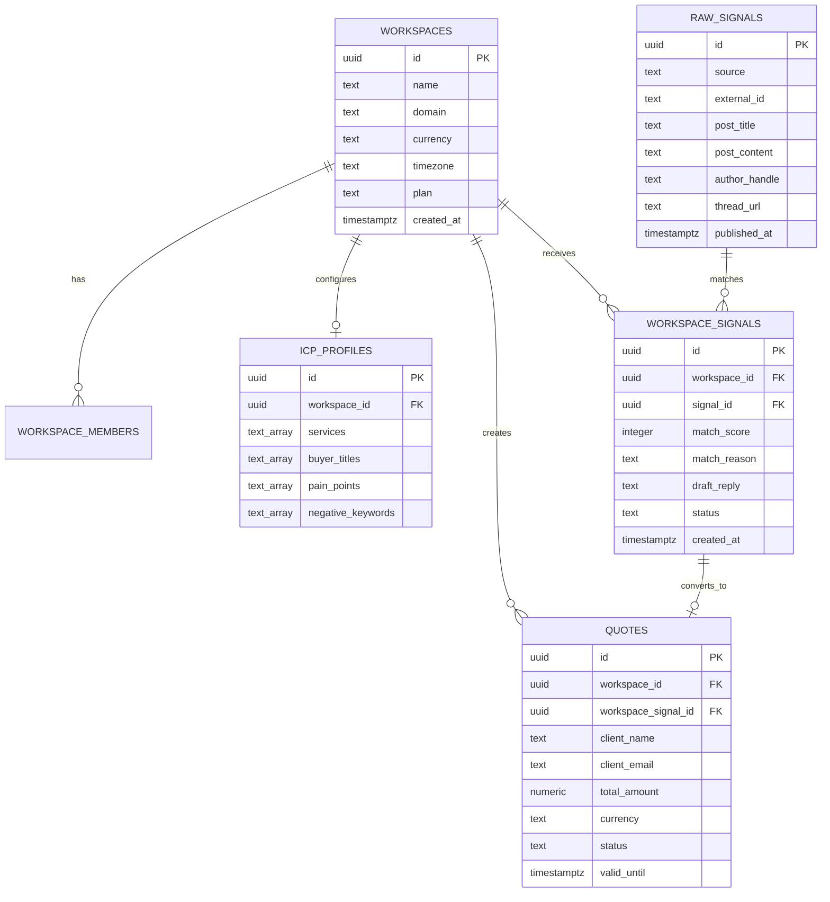

# WinThread Core Architecture & Technical Stack Specification

**Document Identifier:** ARCH-WINTHREAD-2026-11-23  
**Stage:** Stage 2 (Architecture & Impact)  
**Status:** Approved & Locked Architecture  
**Target Application:** WinThread — B2B Buyer Intent & Agency Client Acquisition OS  

---

## 1. System Topology Overview

WinThread uses a modern, high-performance **3-Tier Cloud Architecture**:

```
┌─────────────────────────────────────────────────────────────────────────┐
│                      CLIENT LAYER (Browser / Device)                    │
│  • React 19.3.0 Client Components                                       │
│  • Tailwind CSS 4 Utility Styling                                       │
│  • Lucide React Icons & Framer Motion Animations                        │
│  • Optimistic UI Updates & Instant Local State                          │
└────────────────────────────────────┬────────────────────────────────────┘
                                     │
                      (Encrypted TLS / Server Actions)
                                     │
                                     ▼
┌─────────────────────────────────────────────────────────────────────────┐
│                   SERVER / RUNTIME LAYER (Next.js 16.4.6)               │
│  • Next.js Server Components (Zero-Bundle Data Fetching)                │
│  • Type-Safe Server Actions (UI Form Submissions & Mutations)           │
│  • Edge / Node Runtime Route Handlers (/api/webhooks/stripe)            │
│  • 3-Tier Multi-Dimensional Intent Engine (MDIE Scoring)                │
└────────────────────────────────────┬────────────────────────────────────┘
                                     │
               (Direct Postgres Connection Pooling via Supabase SSR)
                                     │
                                     ▼
┌─────────────────────────────────────────────────────────────────────────┐
│                    DATABASE & AUTH LAYER (Supabase)                     │
│  • PostgreSQL 16 (Relational Tables, Foreign Keys, Indexes)             │
│  • Supabase Auth (Email/Password, Google OAuth, Session Tokens)         │
│  • Row-Level Security (RLS) Policies (Strict Multi-Tenant Isolation)    │
│  • Supabase Storage (Agency Logos & Deliverables)                       │
└─────────────────────────────────────────────────────────────────────────┘
```

---

## 2. Complete Technical Stack

| Layer | Technology | Version | Purpose & Rationale |
| :--- | :--- | :--- | :--- |
| **Framework** | **Next.js** | `16.4.6` | App Router, Server Actions, Fast Server-Side Rendering (SSR). |
| **UI Library** | **React** | `19.3.0` | Latest concurrent rendering features, Actions, and Server Components. |
| **Language** | **TypeScript** | `5.8+` | Strict static type safety across database, server, and UI layers. |
| **Styling** | **Tailwind CSS** | `v4.0` | High-speed CSS engine with zero runtime performance cost. |
| **Database** | **PostgreSQL (Supabase)** | `16` | Relational integrity, JSONB support, ACID transactions. |
| **Security** | **Supabase RLS** | Latest | Hardware-enforced tenant isolation per workspace. |
| **Auth** | **Supabase Auth SSR** | `@supabase/ssr` | Cookie-based session tokens with automatic refresh. |
| **Icons** | **Lucide React** | Latest | Lightweight, clean, accessible SVG icon suite. |
| **Payments** | **Stripe** | Latest | Global USD subscription billing and client invoice checkouts. |
| **Unit Testing** | **Vitest** | Latest | Ultra-fast unit & TDD test runner matching Turbopack speeds. |
| **E2E Testing** | **Playwright** | Latest | Real browser automation verifying user journeys (Stage 7). |

---

## 3. Core Database Entities (The 5 Fundamental Tables)



---

## 4. The 3-Tier Multi-Dimensional Intent Engine (MDIE)

When a post is ingested from **Reddit** or **Hacker News**, it travels through a 3-stage pipeline:

1. **Tier 1: Lexical Fast Gate ($0 Cost, < 1ms):**
   * Discards 80% of junk using deterministic negative keywords (`intern`, `homework`, `free`, `student`).
   * Verifies word count (> 15 words) and filters out URL-only spam.
2. **Tier 2: Semantic Intent Classifier:**
   * Calculates intent weight:
     * `Switch Intent` (Dissatisfied with competitor) = **1.0**
     * `Direct Recommendation Request` = **0.9**
     * `Acute Pain / Bottleneck Expression` = **0.8**
     * `General Discussion` = **0.2 (Discarded)**
   * Confirms author has commercial decision-making authority.
3. **Tier 3: Context & Action Generation (WinThread Moat):**
   * Computes final Match Score ($0–100\%$).
   * Generates the 1-Sentence Reason: *"Prospect is missing calls and looking for an automated receptionist."*
   * Generates non-spam **Reply Studio draft** ready to copy-paste.
   * Generates the **Pre-Populated Quote Proposal** ready to send.

---

## 5. Security & Isolation Invariant (Row-Level Security)

Every table holding agency data enforces this strict PostgreSQL rule:

```sql
ALTER TABLE workspace_signals ENABLE ROW LEVEL SECURITY;

CREATE POLICY workspace_isolation ON workspace_signals
  USING (workspace_id = (auth.jwt()->>'workspace_id')::uuid);
```

* **The Security Guarantee:** Agency A can never read, query, or edit Agency B's leads, quotes, or settings. All access is blocked at the database engine level.

---

## 6. The 4 User Journeys

1. **Onboarding Flow (`/` $\rightarrow$ `/setup`):**  
   User enters website $\rightarrow$ 4-stage scanner runs $\rightarrow$ Reviews ICP tags $\rightarrow$ Signs up with Google at the end to save workspace (*Magic First*).
2. **Lead Discovery Flow (`/feed`):**  
   Pre-loaded with 5–8 high-intent starter leads matching their niche $\rightarrow$ Background scanner continuously adds live posts from Reddit & Hacker News.
3. **Engagement Flow (`/feed` Modal):**  
   Agency owner clicks `[Copy Reply]` to post an authentic answer to the discussion.
4. **Deal Closing Flow (`/quotes`):**  
   Agency owner clicks `[Generate Quote]` directly on a lead card $\rightarrow$ Review pricing line items $\rightarrow$ Click "Send Quote" to issue a client-facing proposal and collect payment.
