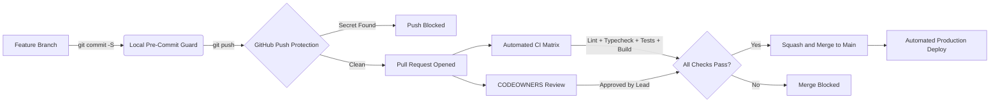

# Enterprise GitHub Standards, Architecture, and Repository Governance

**Document Identifier:** RESEARCH-WINTHREAD-GITHUB-006  
**Language Standard:** ASD-STE100 (Simplified Technical English)  
**Primary Sources:** Official GitHub Documentation (`docs.github.com`), Next.js Production CI Documentation  
**Target Application:** WinThread (Next.js 16, TypeScript, Supabase SSR, Vitest, Tailwind CSS 4)  
**Date:** 2026-11-25  

---

## 1. Executive Summary & Purpose

This document gives technical rules for managing Git and GitHub in enterprise production environments. It explains what files you must track in Git, what files you must exclude, how large technology companies operate GitHub from end to end, and what flaws currently exist in the WinThread repository.

---

## 2. Priority List: Flaws in Current Approach & Critical Gaps

The table below shows what is missing or flawed in the current WinThread repository before you push to a remote GitHub repository. Items are arranged in order of priority:

| Priority | Risk Level | Area | Description of Flaw | Operational Consequence | Required Immediate Action |
| :--- | :--- | :--- | :--- | :--- | :--- |
| **P0** | **CRITICAL** | File Tracking | The entire `docs/` folder is currently **untracked** in Git (`git status` shows `?? docs/`). | If you push to GitHub now, zero documentation files (`LEARNING_GUIDE.md`, `PLAYBOOK.md`, `PRD.md`, `DATABASE.md`) will exist on GitHub. Your friend will see nothing. | Add and commit `docs/` explicitly before setting the remote. |
| **P0** | **CRITICAL** | Secret Leak Prevention | `.gitignore` does not ignore local machine files (`.vscode/`, `.claude/`, `review_findings.json`, `scan_denials.js`). | Editor settings with hardcoded absolute user paths (`C:\Users\kavur\...`), local AI agent transcripts, and scratch files will be pushed to GitHub. | Update `.gitignore` with strict exclusion patterns immediately. |
| **P1** | **HIGH** | History Permanence | Developers believe `git rm` deletes secrets. In Git's Directed Acyclic Graph (DAG), committed blobs remain in commit history forever. | Deleting a secret in commit 2 does not remove it from commit 1. Malicious bots scrape commit trees in under 5 seconds. | Verify that zero `.env` or credential files exist in previous commits (`git log`). |
| **P1** | **HIGH** | Automation / CI | Zero GitHub Actions workflows exist (`.github/workflows/` does not exist). | When a teammate or friend pushes code or opens a PR, no automated system verifies compilation, tests, or security. Broken code enters `master`. | Create `.github/workflows/ci.yml` running lint, typecheck, tests, and build. |
| **P2** | **MEDIUM** | Branch Security | All commits are made directly to `master`. | Zero peer reviews, zero status checks, accidental force-pushes (`git push --force`) can erase production code. | Configure GitHub Rulesets on `main`/`master` (require PR, require CI pass, block force-push). |
| **P2** | **MEDIUM** | Identity Verification | Commits are not cryptographically signed (GPG/SSH). | Any actor can forge Git commit author headers (`git commit --author="boss@company.com"`). | Enable SSH or GPG commit signing on developer workstations. |
| **P3** | **LOW** | Governance Files | Missing standard collaboration files (`.github/CODEOWNERS`, `PULL_REQUEST_TEMPLATE.md`, `ISSUE_TEMPLATE/`). | Pull requests lack structured checklists. Security-sensitive directories lack mandatory reviewer gates. | Add CODEOWNERS and PR templates to `.github/`. |

---

## 3. What to Add to GitHub vs What NOT to Add (and WHY)

Git is a version control system for **source code and configuration as code**. It is **not** an operating system backup tool, a credential store, or a binary artifact warehouse.

```
┌────────────────────────────────────────────────────────────────────────┐
│                        GIT REPOSITORY TAXONOMY                         │
├───────────────────────────────────┬────────────────────────────────────┤
│           MUST COMMIT             │            MUST EXCLUDE            │
│       (Configuration as Code)     │       (Secrets, Builds, Bloat)     │
├───────────────────────────────────┼────────────────────────────────────┤
│ • Application code (app, lib, ...)│ • Environment secrets (.env*)      │
│ • Database migrations (*.sql)     │ • Dependencies (node_modules/)     │
│ • Package manifests (package.json)│ • Build caches (.next/, build/)    │
│ • Frozen lockfile (package-lock)  │ • Local IDE files (.vscode, .idea) │
│ • Automated test suites (tests/)  │ • Scratch scripts & audit logs     │
│ • Documentation (docs/, README.md)│ • OS metadata (.DS_Store, Thumbs)  │
│ • CI/CD automation (.github/)     │ • TypeScript build info (*.tsbuild)│
└───────────────────────────────────┴────────────────────────────────────┘
```

### 3.1 Files You MUST Add (and Technical Reasons)

1. **Source Code (`app/`, `components/`, `lib/`, `public/`):**
   * *Reason:* This is the functional intellectual property of the application.
2. **Database Schema & Migrations (`supabase/migrations/*.sql`):**
   * *Reason:* Database state must be deterministic. Every migration script must be versioned so that local, staging, and production databases execute the identical schema sequence.
3. **Dependency Manifests (`package.json` AND `package-lock.json`):**
   * *Why `package-lock.json` is mandatory:* `package.json` specifies semantic version ranges (e.g. `^19.0.0`). Two developers running `npm install` on different days will get different sub-dependencies if the lockfile is missing. `package-lock.json` pins the exact SHA-512 integrity hashes and exact tree. In enterprise CI/CD, builds execute `npm ci`, which aborts if `package-lock.json` is absent.
4. **Tool & Compiler Configurations (`tsconfig.json`, `eslint.config.mjs`, `next.config.ts`, `vitest.config.mts`):**
   * *Reason:* Every developer and CI runner must compile TypeScript and execute tests under identical compiler flags.
5. **Architectural & Learning Documentation (`docs/`, `README.md`, `docs/LEARNING_GUIDE.md`):**
   * *Reason:* Code without architecture documentation produces institutional knowledge loss. Storing docs inside the repo guarantees documentation versions match software versions.
6. **CI/CD & Repository Governance (`.github/workflows/*.yml`, `.github/CODEOWNERS`, `.github/PULL_REQUEST_TEMPLATE.md`):**
   * *Reason:* Automation rules must be version-controlled alongside application code.

### 3.2 Files You MUST NEVER Add (and Technical Reasons)

1. **Secrets, Keys & Environment Variables (`.env`, `.env.local`, `.env.production`, `*.pem`, `*.key`):**
   * *The Threat:* GitHub is mirrored by automated scrapers in real time. Leaking a `SUPABASE_SERVICE_ROLE_KEY` or `DATABASE_URL` gives attackers instant full database read/write access.
   * *Rule:* Commit non-sensitive template files only (e.g. `.env.example`).
2. **Third-Party Dependencies (`node_modules/`, `.pnp/`):**
   * *The Threat:* `node_modules` contains tens of thousands of platform-dependent files (compiled C++ binaries, symlinks). Committing dependencies causes multi-gigabyte repository bloat, slow clone times, and cross-platform compilation failures between Windows, Linux, and macOS.
3. **Build Outputs & Ephemeral Caches (`.next/`, `/out/`, `/build/`, `/dist/`, `*.tsbuildinfo`):**
   * *The Threat:* These files change on every single compile. Committing them creates massive merge conflicts on every pull request and pollutes git diffs with unreadable minified code.
4. **Developer Workstation / Agent Preferences (`.vscode/`, `.idea/`, `.claude/`):**
   * *The Threat:* These directories store personal machine settings, local plugin states, and absolute file paths (`C:\Users\kavur\...`). Committing them overwrites other developers' editor configurations and breaks tools.
5. **Execution Logs, Test Coverage, & Scratch Files (`coverage/`, `*.log`, `review_findings.json`, `scan_denials.js`):**
   * *The Threat:* Ephemeral operational artifacts that add noise to pull requests and leak internal diagnostic data.
6. **Operating System Files (`.DS_Store`, `Thumbs.db`, `desktop.ini`):**
   * *The Threat:* Desktop thumbnail and folder caches created automatically by Windows and macOS.

---

## 4. How Enterprise Technology Companies Use GitHub End-to-End

Large software companies (such as Stripe, Vercel, Meta, and Shopify) treat GitHub as a **governed release pipeline**, not just a storage disk.



### 4.1 Branching Model: Trunk-Based Development (TBD)
* Enterprise companies avoid long-lived branches (such as legacy GitFlow with `develop`, `release`, `staging`, `feature` branches that live for months).
* **The Modern Standard:** **Trunk-Based Development**.
  - All developers branch off `main` (or `master`).
  - Feature branches are short-lived (lifespan < 24 to 48 hours).
  - Merges into `main` occur frequently in small batches.
  - Large features are guarded behind **Feature Flags**, not long-lived branches.

### 4.2 Branch Protection via GitHub Rulesets
Companies never permit direct pushes to `main`. They enforce **GitHub Rulesets**:
1. **Require Pull Request Reviews:**
   - Minimum 1 to 2 peer approvals.
   - **Dismiss stale reviews:** If a PR is approved, and the author pushes 1 more commit, the approval is revoked automatically.
   - **Require Code Owner review:** Changes to sensitive paths (e.g., `lib/scraper/ssrf.ts` or `supabase/migrations/`) must have approval from the designated security owner.
2. **Require Status Checks to Pass (Strict Mode):**
   - CI test runners must complete with exit code 0.
   - **Strict Branch Up-to-Date Rule:** The feature branch must be rebased with the latest commit on `main` before merging. This prevents "semantic merge conflicts" where PR A and PR B pass CI separately, but break when combined.
3. **Require Linear History:**
   - Merge commits (which create tangled 3-way graph bubbles) are blocked.
   - Merges must use **Squash and Merge** (collapses PR commits into one clean commit) or **Rebase and Merge**.
4. **Block Force Pushes & Branch Deletions:**
   - Prevents `git push --force`, preserving audit history permanently.
5. **Require Signed Commits:**
   - Commits without verified GPG or SSH cryptographic signatures are rejected.

### 4.3 Automated Continuous Integration (CI) Matrix
On every Pull Request, GitHub Actions automatically executes the **Five Gates of CI**:
* **Gate 1: Dependency Check (`npm ci`):** Installs frozen dependencies in a clean VM.
* **Gate 2: Code Quality (`npm run lint`):** Enforces linting rules.
* **Gate 3: Type Safety (`npx tsc --noEmit`):** Verifies zero TypeScript diagnostic errors.
* **Gate 4: Automated Tests (`npm test`):** Executes all unit, integration, and contract tests.
* **Gate 5: Production Build (`npm run build`):** Proves the code compiles to production output without runtime bundling errors.

### 4.4 Automated Security Scanning
* **GitHub Secret Scanning & Push Protection:** Scans code *before* the push is accepted. If a private key or API token is in the commit, GitHub rejects the push immediately at the terminal.
* **Dependabot Alerts & Automated Updates:** Scans `package-lock.json` against the National Vulnerability Database (NVD). If a dependency has a security vulnerability (CVE), Dependabot opens an automated PR with the patched version.
* **CodeQL / SAST (Static Application Security Testing):** Analyzes the code's data flow to detect vulnerabilities (such as SQL injection, SSRF, and Cross-Site Scripting).

---

## 5. Step-by-Step Remediation Plan for WinThread

To bring the WinThread repository to enterprise standards, complete the following steps in sequence:

### Step 1: Update `.gitignore`
Append missing local, editor, and scratch patterns to `.gitignore`:
```gitignore
# IDE and editors
.vscode/
.idea/

# AI agent local configurations and scratch files
.claude/
scan_denials.js
review_findings.json

# Local environment overrides
*.local
```

### Step 2: Track Core Documentation (`docs/`)
Currently, `docs/` is untracked. Add all documentation files to Git:
```bash
git add docs/
git commit -m "docs: track comprehensive system architecture and learning guide"
```

### Step 3: Create GitHub Actions Workflow (`.github/workflows/ci.yml`)
Create `.github/workflows/ci.yml` so that every future push and pull request is automatically verified:
```yaml
name: CI

on:
  push:
    branches: [master, main]
  pull_request:
    branches: [master, main]

concurrency:
  group: ${{ github.workflow }}-${{ github.ref }}
  cancel-in-progress: ${{ github.ref != 'refs/heads/master' && github.ref != 'refs/heads/main' }}

jobs:
  verify:
    name: Lint, Typecheck, Test & Build
    runs-on: ubuntu-latest
    timeout-minutes: 10

    steps:
      - name: Checkout Code
        uses: actions/checkout@v4

      - name: Set up Node.js
        uses: actions/setup-node@v4
        with:
          node-version: 20
          cache: 'npm'

      - name: Install Dependencies
        run: npm ci

      - name: Cache Next.js Build
        uses: actions/cache@v4
        with:
          path: ${{ github.workspace }}/.next/cache
          key: ${{ runner.os }}-nextjs-${{ hashFiles('**/package-lock.json') }}-${{ hashFiles('**.[jt]s', '**.[jt]sx') }}
          restore-keys: |
            ${{ runner.os }}-nextjs-${{ hashFiles('**/package-lock.json') }}-

      - name: Type Check
        run: npx tsc --noEmit

      - name: Run Tests
        run: npm test

      - name: Build Next.js Application
        run: npm run build
        env:
          NEXT_TELEMETRY_DISABLED: 1
```

### Step 4: Add Pull Request Template (`.github/PULL_REQUEST_TEMPLATE.md`)
Standardize all future PRs with a clean verification checklist.

### Step 5: Link Remote & Push
Only after Steps 1–4 are committed locally:
1. Create new private repository on GitHub (do NOT initialize with README or license; keep empty).
2. Set the remote:
   ```bash
   git remote add origin https://github.com/<your-username>/winthread.git
   ```
3. Push the clean `master` branch:
   ```bash
   git push -u origin master
   ```
4. Configure Branch Ruleset on GitHub (Settings > Rules > Rulesets):
   - Target: default branch (`master`).
   - Require Pull Request before merging.
   - Require status checks to pass (`verify`).
   - Block force pushes.
   - Enable Secret Scanning & Push Protection (Settings > Code security).

---

*End of Enterprise GitHub Standards Research Document. Reference this specification before publishing code to remote repositories.*
